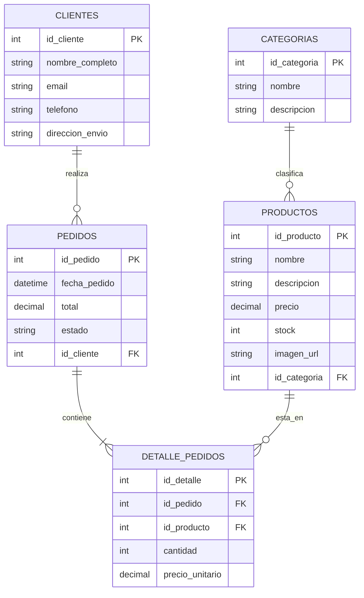

# Actividad Inicial: Introducción a las Bases de Datos

## Paso 1: Contexto elegido
**Tienda Online de Café y Equipamiento ("Tienda del Barista")**  
Un sistema e-commerce dedicado a la venta de insumos para el café, accesorios de barismo (molinos, balanzas, pavas) y recepción de consultas de clientes.

---

## Paso 2: Identificación de entidades y atributos

Para gestionar el catálogo, las ventas y los clientes de la tienda, necesitamos las siguientes entidades (tablas):

1. **Categorías**
   * `id_categoria`: Identificador único de la categoría.
   * `nombre`: Nombre de la categoría (ej. *Métodos de Filtrado*, *Accesorios*).
   * `descripcion`: Breve detalle de los productos que agrupa.

2. **Productos**
   * `id_producto`: Identificador único del producto.
   * `nombre`: Nombre comercial (ej. *Cafetera Chemex 6 Tazas*, *Hario V60 Cerámica*).
   * `descripcion`: Detalles técnicos del producto.
   * `precio`: Valor de venta (ej. *45000*, *22500*).
   * `stock`: Cantidad disponible en inventario.
   * `imagen_url`: Enlace a la fotografía del producto.
   * `id_categoria`: Categoría a la que pertenece el producto.

3. **Clientes**
   * `id_cliente`: Identificador único del cliente.
   * `nombre_completo`: Nombre y apellido (ej. *María Gómez*).
   * `email`: Correo electrónico de contacto.
   * `telefono`: Número de teléfono.
   * `direccion_envio`: Calle, número y ciudad para la entrega.

4. **Pedidos**
   * `id_pedido`: Identificador único de la compra.
   * `fecha_pedido`: Fecha y hora en que se realizó el pedido.
   * `total`: Monto total a pagar.
   * `estado`: Estado actual (ej. *Pendiente*, *Pagado*, *Enviado*).
   * `id_cliente`: Cliente que realizó la compra.

5. **Detalle_Pedidos** *(Tabla intermedia para saber qué productos lleva cada pedido)*
   * `id_detalle`: Identificador único del renglón del pedido.
   * `id_pedido`: Pedido al que pertenece.
   * `id_producto`: Producto comprado.
   * `cantidad`: Unidades compradas de ese producto.
   * `precio_unitario`: Precio del producto al momento de la compra.

---

## Paso 3: Definición de claves (PK y FK)

| Tabla | Clave Primaria (PK) | Claves Foráneas (FK) |
| :--- | :--- | :--- |
| **Categorías** | `id_categoria` | *Ninguna* |
| **Productos** | `id_producto` | `id_categoria` (referencia a `Categorías.id_categoria`) |
| **Clientes** | `id_cliente` | *Ninguna* |
| **Pedidos** | `id_pedido` | `id_cliente` (referencia a `Clientes.id_cliente`) |
| **Detalle_Pedidos** | `id_detalle` | `id_pedido` (referencia a `Pedidos.id_pedido`) `id_producto` (referencia a `Productos.id_producto`) |

---

## Paso 4: Relaciones entre entidades

* **Categorías y Productos (1 a N):**
  * *"Una categoría puede tener varios productos."*
  * *"Cada producto pertenece a una sola categoría."*
* **Clientes y Pedidos (1 a N):**
  * *"Un cliente puede realizar varios pedidos a lo largo del tiempo."*
  * *"Cada pedido pertenece a un único cliente."*
* **Pedidos y Productos (N a M, resuelta mediante `Detalle_Pedidos`):**
  * *"Un pedido puede incluir varios productos distintos (ej. una Chemex y una Balanza)."*
  * *"Un mismo producto puede estar incluido en muchos pedidos diferentes."*

---

## Paso 5: Modelo de datos (Diagrama Entidad-Relación)

### Representación esquemática en texto (para pasar a Draw.io / MySQL Workbench):
* `[Categorías] 1 ────< N [Productos]`
* `[Clientes] 1 ────< N [Pedidos]`
* `[Pedidos] 1 ────< N [Detalle_Pedidos] N >──── 1 [Productos]`

---

## Parte 6: Reflexión Final

**1. ¿Qué fue lo más fácil y lo más difícil al diseñar tu base de datos?**
* **Lo más fácil:** Identificar las entidades principales (`Productos`, `Categorías`, `Clientes`) y sus atributos básicos, ya que se desprenden directamente de lo que vemos en la interfaz visual del catálogo web.
* **Lo más difícil:** Resolver la relación de * muchos a muchos* entre `Pedidos` y `Productos`. Al principio uno piensa en poner el producto directamente dentro de la tabla `Pedidos`, pero como un cliente puede comprar varios artículos en un mismo carrito, fue necesario pensar en la tabla intermedia `Detalle_Pedidos` y guardar allí el `precio_unitario` histórico por si los precios aumentan en el futuro.

* Segundo Trabajo Integrador 
Modelado de base de datos y consultas SQL 
Proyecto: Tienda del Barista 
1. Descripción del proyecto 
El proyecto consiste en desarrollar una base de datos para una tienda online dedicada a la 
comercialización de café, insumos y equipamiento de barismo. 
El sistema permitirá administrar las categorías y productos disponibles, registrar clientes, 
almacenar pedidos y detallar los productos incluidos en cada compra. 
2. Elección del motor de base de datos 
Se seleccionó SQLite como motor de base de datos. 
Se eligió por ser gratuito, liviano, fácil de utilizar y compatible con el lenguaje SQL. No 
requiere un servidor independiente y permite desarrollar y probar las consultas necesarias 
para el proyecto. 
3. Identificación de entidades y atributos 
La base de datos estará compuesta por cinco tablas: 
CATEGORIAS - id_categoria: identificador único (PK). - nombre: nombre de la categoría. - descripcion: descripción de la categoría. 
PRODUCTOS - id_producto: identificador único (PK). - nombre: nombre comercial del producto. - descripcion: descripción del producto. - precio: precio de venta. - stock: cantidad disponible. - imagen_url: dirección de la imagen. - id_categoria: categoría correspondiente (FK). 
CLIENTES - id_cliente: identificador único (PK). - nombre_completo: nombre y apellido. - email: correo electrónico. - telefono: teléfono de contacto. 
- direccion_envio: domicilio de entrega. 
 
PEDIDOS 
 - id_pedido: identificador único (PK). - fecha_pedido: fecha y hora de realización. - total: importe total. - estado: estado actual del pedido. - id_cliente: cliente que realizó la compra (FK). 
 
DETALLE_PEDIDOS 
 - id_detalle: identificador único (PK). - id_pedido: pedido correspondiente (FK). - id_producto: producto incluido (FK). - cantidad: unidades compradas. - precio_unitario: precio del producto al momento de la compra. 
 
4. Modelo entidad-relación 
 
Las relaciones establecidas son: 
 - CATEGORIAS (1:N) PRODUCTOS. - CLIENTES (1:N) PEDIDOS. - PEDIDOS (1:N) DETALLE_PEDIDOS. - PRODUCTOS (1:N) DETALLE_PEDIDOS. 
 
La tabla DETALLE_PEDIDOS permite resolver la relación muchos a muchos entre 
PEDIDOS y PRODUCTOS. 
 
Diagrama esquemático 
 
CATEGORIAS 
    1 
    | 
    N 
PRODUCTOS 
    1 
    | 
    N 
DETALLE_PEDIDOS 
    N 
    | 
    1 
PEDIDOS 
    N 
    | 
    1 
CLIENTES 
 
5. Creación de la base de datos y tablas 
 
Se utilizan claves primarias para identificar cada registro y claves foráneas para relacionar 
las tablas. 
 
PRAGMA foreign_keys = ON; 
 
CREATE TABLE Categorias ( 
    id_categoria INTEGER PRIMARY KEY AUTOINCREMENT, 
    nombre TEXT NOT NULL, 
    descripcion TEXT 
); 
 
CREATE TABLE Productos ( 
    id_producto INTEGER PRIMARY KEY AUTOINCREMENT, 
    nombre TEXT NOT NULL, 
    descripcion TEXT, 
    precio REAL NOT NULL CHECK (precio >= 0), 
    stock INTEGER NOT NULL DEFAULT 0 CHECK (stock >= 0), 
    imagen_url TEXT, 
    id_categoria INTEGER NOT NULL, 
    FOREIGN KEY (id_categoria) 
        REFERENCES Categorias(id_categoria) 
); 
 
CREATE TABLE Clientes ( 
    id_cliente INTEGER PRIMARY KEY AUTOINCREMENT, 
    nombre_completo TEXT NOT NULL, 
    email TEXT NOT NULL UNIQUE, 
    telefono TEXT, 
    direccion_envio TEXT 
); 
 
CREATE TABLE Pedidos ( 
    id_pedido INTEGER PRIMARY KEY AUTOINCREMENT, 
    fecha_pedido TEXT NOT NULL DEFAULT CURRENT_TIMESTAMP, 
    total REAL NOT NULL DEFAULT 0 CHECK (total >= 0), 
    estado TEXT NOT NULL DEFAULT 'Pendiente', 
    id_cliente INTEGER NOT NULL, 
    FOREIGN KEY (id_cliente) 
        REFERENCES Clientes(id_cliente) 
); 
 
CREATE TABLE Detalle_Pedidos ( 
    id_detalle INTEGER PRIMARY KEY AUTOINCREMENT, 
    id_pedido INTEGER NOT NULL, 
    id_producto INTEGER NOT NULL, 
    cantidad INTEGER NOT NULL CHECK (cantidad > 0), 
    precio_unitario REAL NOT NULL CHECK (precio_unitario >= 0), 
    FOREIGN KEY (id_pedido) 
        REFERENCES Pedidos(id_pedido), 
    FOREIGN KEY (id_producto) 
        REFERENCES Productos(id_producto), 
    UNIQUE (id_pedido, id_producto) 
); 
 
6. Consultas SQL: operaciones CRUD 
 
CRUD representa las cuatro operaciones fundamentales para administrar información en 
una base de datos: 
 - CREATE: crear registros. - READ: consultar registros. - UPDATE: modificar registros. - DELETE: eliminar registros. 
 
A. CREATE – Insertar registros 
 
Agregar una categoría: 
 
INSERT INTO Categorias (nombre, descripcion) 
VALUES ('Métodos de filtrado', 'Productos para preparar café filtrado'); 
 
Agregar un producto: 
 
INSERT INTO Productos 
(nombre, descripcion, precio, stock, imagen_url, id_categoria) 
VALUES 
('Cafetera Chemex 6 Tazas', 
 'Cafetera de vidrio para café filtrado', 
 45000, 10, 'chemex.jpg', 1); 
 
Registrar un cliente: 
 
INSERT INTO Clientes 
(nombre_completo, email, telefono, direccion_envio) 
VALUES 
('María Gómez', 'maria@email.com', 
 '2215551234', 'Calle 50 N° 500, La Plata'); 
 
Registrar un pedido: 
 
INSERT INTO Pedidos (total, estado, id_cliente) 
VALUES (45000, 'Pendiente', 1); 
Agregar un producto al pedido: 
INSERT INTO Detalle_Pedidos 
(id_pedido, id_producto, cantidad, precio_unitario) 
VALUES (1, 1, 1, 45000); 
B. READ – Consultar registros 
Listar todas las categorías: 
SELECT * FROM Categorias; 
Listar todos los productos: 
SELECT * FROM Productos; 
Consultar productos con sus categorías: 
SELECT Productos.nombre, Productos.precio, 
Categorias.nombre AS categoria 
FROM Productos 
INNER JOIN Categorias 
ON Productos.id_categoria = Categorias.id_categoria; 
Listar todos los clientes: 
SELECT * FROM Clientes; 
Consultar los pedidos de un cliente: 
SELECT * FROM Pedidos 
WHERE id_cliente = 1; 
Consultar los productos incluidos en un pedido: 
SELECT Productos.nombre, 
Detalle_Pedidos.cantidad, 
Detalle_Pedidos.precio_unitario 
FROM Detalle_Pedidos 
INNER JOIN Productos 
ON Detalle_Pedidos.id_producto = Productos.id_producto 
WHERE Detalle_Pedidos.id_pedido = 1; 
C. UPDATE – Modificar registros 
Modificar el precio de un producto: 
UPDATE Productos 
SET precio = 48000 
WHERE id_producto = 1; 
Actualizar el stock de un producto: 
UPDATE Productos 
SET stock = 8 
WHERE id_producto = 1; 
Modificar los datos de un cliente: 
UPDATE Clientes 
SET telefono = '2215559876' 
WHERE id_cliente = 1; 
Cambiar el estado de un pedido: 
UPDATE Pedidos 
SET estado = 'Enviado' 
WHERE id_pedido = 1; 
D. DELETE – Eliminar registros 
Eliminar un producto del detalle de un pedido: 
DELETE FROM Detalle_Pedidos 
WHERE id_detalle = 1; 
Eliminar un pedido: 
DELETE FROM Pedidos 
WHERE id_pedido = 1; 
Eliminar un producto: 
DELETE FROM Productos 
WHERE id_producto = 1; 
Eliminar un cliente: 
DELETE FROM Clientes 
WHERE id_cliente = 1; 
Las eliminaciones deben respetar las relaciones entre tablas. Por eso, primero se deben 
eliminar los registros dependientes de una entidad antes de eliminar esa entidad. 
7. Consultas adicionales 
Consultar los pedidos junto con el nombre del cliente: 
SELECT Pedidos.id_pedido, 
Clientes.nombre_completo, 
Pedidos.fecha_pedido, 
Pedidos.total, 
Pedidos.estado 
FROM Pedidos 
INNER JOIN Clientes 
ON Pedidos.id_cliente = Clientes.id_cliente; 
Calcular el importe de los productos de un pedido: 
SELECT id_pedido, 
SUM(cantidad * precio_unitario) AS subtotal 
FROM Detalle_Pedidos 
GROUP BY id_pedido; 
8. Conclusión 
El desarrollo de este modelo permite organizar la información de una tienda online mediante 
una base de datos relacional. 
La separación de los datos en diferentes tablas evita la duplicación de información y permite 
establecer relaciones entre categorías, productos, clientes y pedidos. 
Mediante las operaciones CRUD se pueden realizar las acciones necesarias para 
administrar los registros del sistema: agregar, consultar, modificar y eliminar información. 
SQLite permite implementar estas estructuras y ejecutar las consultas SQL de manera 
sencilla, constituyendo una herramienta adecuada para el desarrollo del proyecto. 

**2. ¿Por qué creés que es importante modelar antes de crear la base de datos en un sistema real?**
Porque permite detectar errores de lógica, evitar datos duplicados (redundancia) y asegurar que todas las necesidades del negocio estén cubiertas antes de escribir código SQL o programar el backend. Cambiar un dibujo o esquema lleva minutos, mientras que modificar tablas que ya están en producción y tienen datos reales cargados es costoso y riesgoso.
