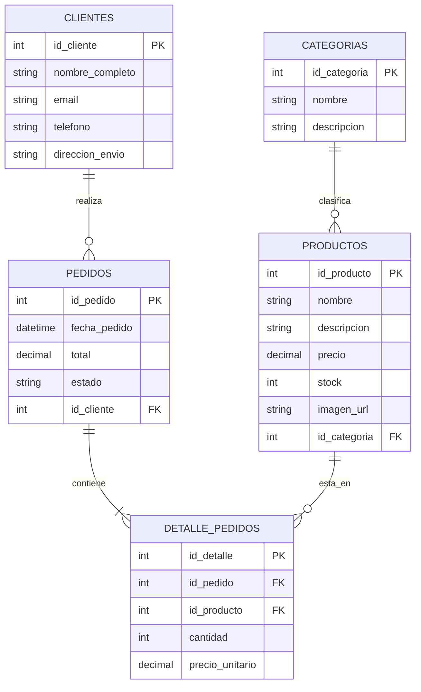

# Actividad Inicial: Introducción a las Bases de Datos

## Paso 1: Contexto elegido
**Tienda Online de Café y Equipamiento ("Tienda del Barista")**  
Un sistema e-commerce dedicado a la venta de insumos para el café, accesorios de barismo (molinos, balanzas, pavas) y recepción de consultas de clientes.

---

## Paso 2: Identificación de entidades y atributos

Para gestionar el catálogo, las ventas y los clientes de la tienda, necesitamos las siguientes entidades (tablas):

1. **Categorías**
   * `id_categoria`: Identificador único de la categoría.
   * `nombre`: Nombre de la categoría (ej. *Métodos de Filtrado*, *Accesorios*).
   * `descripcion`: Breve detalle de los productos que agrupa.

2. **Productos**
   * `id_producto`: Identificador único del producto.
   * `nombre`: Nombre comercial (ej. *Cafetera Chemex 6 Tazas*, *Hario V60 Cerámica*).
   * `descripcion`: Detalles técnicos del producto.
   * `precio`: Valor de venta (ej. *45000*, *22500*).
   * `stock`: Cantidad disponible en inventario.
   * `imagen_url`: Enlace a la fotografía del producto.
   * `id_categoria`: Categoría a la que pertenece el producto.

3. **Clientes**
   * `id_cliente`: Identificador único del cliente.
   * `nombre_completo`: Nombre y apellido (ej. *María Gómez*).
   * `email`: Correo electrónico de contacto.
   * `telefono`: Número de teléfono.
   * `direccion_envio`: Calle, número y ciudad para la entrega.

4. **Pedidos**
   * `id_pedido`: Identificador único de la compra.
   * `fecha_pedido`: Fecha y hora en que se realizó el pedido.
   * `total`: Monto total a pagar.
   * `estado`: Estado actual (ej. *Pendiente*, *Pagado*, *Enviado*).
   * `id_cliente`: Cliente que realizó la compra.

5. **Detalle_Pedidos** *(Tabla intermedia para saber qué productos lleva cada pedido)*
   * `id_detalle`: Identificador único del renglón del pedido.
   * `id_pedido`: Pedido al que pertenece.
   * `id_producto`: Producto comprado.
   * `cantidad`: Unidades compradas de ese producto.
   * `precio_unitario`: Precio del producto al momento de la compra.

---

## Paso 3: Definición de claves (PK y FK)

| Tabla | Clave Primaria (PK) | Claves Foráneas (FK) |
| :--- | :--- | :--- |
| **Categorías** | `id_categoria` | *Ninguna* |
| **Productos** | `id_producto` | `id_categoria` (referencia a `Categorías.id_categoria`) |
| **Clientes** | `id_cliente` | *Ninguna* |
| **Pedidos** | `id_pedido` | `id_cliente` (referencia a `Clientes.id_cliente`) |
| **Detalle_Pedidos** | `id_detalle` | `id_pedido` (referencia a `Pedidos.id_pedido`) `id_producto` (referencia a `Productos.id_producto`) |

---

## Paso 4: Relaciones entre entidades

* **Categorías y Productos (1 a N):**
  * *"Una categoría puede tener varios productos."*
  * *"Cada producto pertenece a una sola categoría."*
* **Clientes y Pedidos (1 a N):**
  * *"Un cliente puede realizar varios pedidos a lo largo del tiempo."*
  * *"Cada pedido pertenece a un único cliente."*
* **Pedidos y Productos (N a M, resuelta mediante `Detalle_Pedidos`):**
  * *"Un pedido puede incluir varios productos distintos (ej. una Chemex y una Balanza)."*
  * *"Un mismo producto puede estar incluido en muchos pedidos diferentes."*

---

## Paso 5: Modelo de datos (Diagrama Entidad-Relación)

### Representación esquemática en texto (para pasar a Draw.io / MySQL Workbench):
* `[Categorías] 1 ────< N [Productos]`
* `[Clientes] 1 ────< N [Pedidos]`
* `[Pedidos] 1 ────< N [Detalle_Pedidos] N >──── 1 [Productos]`

---

## Parte 6: Reflexión Final

**1. ¿Qué fue lo más fácil y lo más difícil al diseñar tu base de datos?**
* **Lo más fácil:** Identificar las entidades principales (`Productos`, `Categorías`, `Clientes`) y sus atributos básicos, ya que se desprenden directamente de lo que vemos en la interfaz visual del catálogo web.
* **Lo más difícil:** Resolver la relación de * muchos a muchos* entre `Pedidos` y `Productos`. Al principio uno piensa en poner el producto directamente dentro de la tabla `Pedidos`, pero como un cliente puede comprar varios artículos en un mismo carrito, fue necesario pensar en la tabla intermedia `Detalle_Pedidos` y guardar allí el `precio_unitario` histórico por si los precios aumentan en el futuro.

**2. ¿Por qué creés que es importante modelar antes de crear la base de datos en un sistema real?**
Porque permite detectar errores de lógica, evitar datos duplicados (redundancia) y asegurar que todas las necesidades del negocio estén cubiertas antes de escribir código SQL o programar el backend. Cambiar un dibujo o esquema lleva minutos, mientras que modificar tablas que ya están en producción y tienen datos reales cargados es costoso y riesgoso.